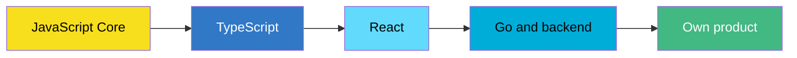

<div align="center">


<a href="https://github.com/RZhurakovskiy">
  
</a>

<br />


<br /><br />


<br /><br />

<a href="#about"></a>
<a href="#stack"></a>
<a href="#projects"></a>
<a href="#stats"></a>
<a href="#roadmap"></a>

</div>

<br />

<div align="center">
  
</div>

```ts
const roman = {
  role: "Fullstack Developer",
  experience: "3+ years, mostly frontend",
  domain: "MES systems for industry",
  frontend: ["Vue 3", "React", "TypeScript"],
  backend: ["Next.js", "Prisma", "PostgreSQL", "Go (Fiber)"],
  learning: ["JavaScript Core", "TypeScript", "React"],
  goal: "launch my own product",
}
```

**Русский.** Fullstack-разработчик, больше 3 лет коммерческого опыта, основной упор на фронтенд. Делаю MES-системы для промышленности и сам веду весь цикл: от сбора требований до тестирования на производстве. До разработки работал на заводе, поэтому знаю, как софт выглядит с точки зрения цеха, а не только кода. Самоучка. Сейчас системно углубляю JavaScript, перехожу на TypeScript и React и параллельно делаю собственные продукты.

**English.** Fullstack developer with 3+ years of commercial experience, mostly on the frontend side. I build MES systems for industry and own the whole cycle, from requirements gathering to testing on the shop floor. Before development I worked in manufacturing, so I see software from the factory floor's point of view, not only from the code's. Self-taught. Right now I'm going deep on JavaScript, moving on to TypeScript and React, and building my own products on the side.

<table>
  <tr>
    <td width="33%" valign="top">

**Фронтенд / Frontend**

Vue 3 изнутри: реактивность, Composition API, `effectScope`. Рефакторинг больших компонентов, архитектура, поиск утечек памяти.

Vue 3 internals, large component refactoring, architecture, memory leak hunting.

</td>
    <td width="33%" valign="top">

**Бэкенд / Backend**

Next.js, Prisma, PostgreSQL. Небольшие сервисы и внутренние инструменты на Go (Fiber).

Next.js, Prisma, PostgreSQL. Small services and internal tools in Go (Fiber).

</td>
    <td width="33%" valign="top">

**Продукт / Product**

Ищу идею для собственного продукта: SaaS или Telegram Mini App.

Looking for an idea for my own product: a SaaS or a Telegram Mini App.

</td>
  </tr>
</table>

<br />

<div align="center">
  


<br />

</div>

<br />

<div align="center">
  

<table>
  <tr>
    <td width="50%" valign="top">
      <a href="https://github.com/RZhurakovskiy/portfolio">
        
      </a>
    </td>
    <td width="50%" valign="top">
      <a href="https://github.com/RZhurakovskiy/prosto-schet">
        
      </a>
    </td>
  </tr>
  <tr>
    <td width="50%" valign="top">
      <a href="https://github.com/RZhurakovskiy/Live-Beat">
        
      </a>
    </td>
    <td width="50%" valign="top">
      <a href="https://github.com/RZhurakovskiy/amada-cnc-simulator">
        
      </a>
    </td>
  </tr>
</table>
</div>

<br />

<div align="center">
  


<br />


<br />


<br />


</div>

<br />

<div align="center">
  
</div>



<div align="center">

**Открыт к интересным задачам и сотрудничеству**
<br />
**Open to interesting work and collaboration**


</div>
