<div align="center">



<a href="https://github.com/RZhurakovskiy">
  
</a>

<br />


<br /><br />


<br /><br />

<a href="#about"></a>
<a href="#stack"></a>
<a href="#projects"></a>
<a href="#stats"></a>

</div>

<br />

<div align="center">
  
</div>

```ts
const roman = {
  role: "Fullstack Developer",
  experience: "3+ years",
  domain: "MES systems for industry",
  web: ["React", "Next.js", "TypeScript", "Vue 3"],
  mobile: ["React Native", "Expo"],
  backend: ["Go (Fiber)", "Prisma", "PostgreSQL"],
  goal: "launch my own product",
}
```

**Русский.** Fullstack-разработчик, больше 3 лет коммерческого опыта. Делаю MES-системы для промышленности и сам веду весь цикл: от сбора требований до тестирования на производстве. Пишу веб-приложения на React, Next.js и Vue 3, мобильные приложения на React Native и бэкенд на Go и Next.js. До разработки работал на заводе, поэтому знаю, как софт выглядит с точки зрения цеха, а не только кода. Параллельно делаю собственные веб и мобильные продукты.

**English.** Fullstack developer with 3+ years of commercial experience. I build MES systems for industry and own the whole cycle, from requirements gathering to testing on the shop floor. I write web apps in React, Next.js and Vue 3, mobile apps in React Native, and backends in Go and Next.js. Before development I worked in manufacturing, so I see software from the factory floor's point of view, not only from the code's. On the side I build my own web and mobile products.

<table>
  <tr>
    <td width="25%" valign="top">

**Web**

React, Next.js, TypeScript, Vue 3. Рефакторинг больших компонентов, архитектура, поиск утечек памяти.

Large component refactoring, architecture, memory leak hunting.

</td>
    <td width="25%" valign="top">

**Mobile**

React Native и Expo. Приложения с Bluetooth-датчиками и картой.

React Native and Expo. Apps with Bluetooth sensors and maps.

</td>
    <td width="25%" valign="top">

**Backend**

Go (Fiber), Next.js, Prisma, PostgreSQL. Сервисы и внутренние инструменты.

Services and internal tools.

</td>
    <td width="25%" valign="top">

**Product**

Собственные продукты: SaaS и Telegram Mini App.

My own products: SaaS and Telegram Mini Apps.

</td>
  </tr>
</table>

<br />

<div align="center">
  


<br />


<br /><br />


</div>

<br />

<div align="center">
  

<table>
  <tr>
    <td width="50%" valign="top">
      <a href="https://github.com/RZhurakovskiy/Live-Beat"><b>LiveBeat</b></a>
      <br /><br />
      Android-приложение для тренировок. Пульс с нагрудного датчика по Bluetooth, зоны нагрузки, GPS-трек на карте и разбор каждой тренировки. Все данные хранятся на телефоне.
      <br /><br />
      <sub>Android workout app. Heart rate from a chest strap over Bluetooth, intensity zones, a GPS track on the map and a breakdown of every workout. All data stays on the phone.</sub>
      <br /><br />
         
    </td>
    <td width="50%" valign="top">
      <b>ТочныйРасчёт</b>
      <br /><br />
      Сайт с 17 калькуляторами выплат и налогов по нормам 2026 года: увольнение, больничные, декретные, алименты, НДФЛ, ипотека.
      <br /><br />
      <sub>A website with 17 payroll and tax calculators following 2026 rules: dismissal pay, sick leave, maternity, alimony, income tax, mortgage.</sub>
      <br /><br />
         
    </td>
  </tr>
  <tr>
    <td width="50%" valign="top">
      <a href="https://github.com/RZhurakovskiy/nexora-nexus-oracle-insight"><b>Nexora</b></a>
      <br /><br />
      Мониторинг системы и управление процессами в реальном времени: CPU, RAM, процессы, порты, история метрик. Клиент на Vue 3, агент на Go.
      <br /><br />
      <sub>Real-time system monitoring and process management: CPU, RAM, processes, ports, metric history. Vue 3 client and a Go agent.</sub>
      <br /><br />
         
    </td>
    <td width="50%" valign="top">
      <a href="https://github.com/RZhurakovskiy/aig-bor-glass-factory-vacansy-go-fiber"><b>HR Automotive</b></a>
      <br /><br />
      Коммерческий проект: сайт вакансий завода с админкой. Первая версия на Gulp, позже переписан на Go (Fiber).
      <br /><br />
      <sub>Commercial project: a factory careers website with an admin panel. First version on Gulp, later rewritten in Go (Fiber).</sub>
      <br /><br />
         
    </td>
  </tr>
</table>
</div>

<br />

<div align="center">
  


<br /><br />

**Открыт к интересным задачам и сотрудничеству**
<br />
**Open to interesting work and collaboration**


</div>
